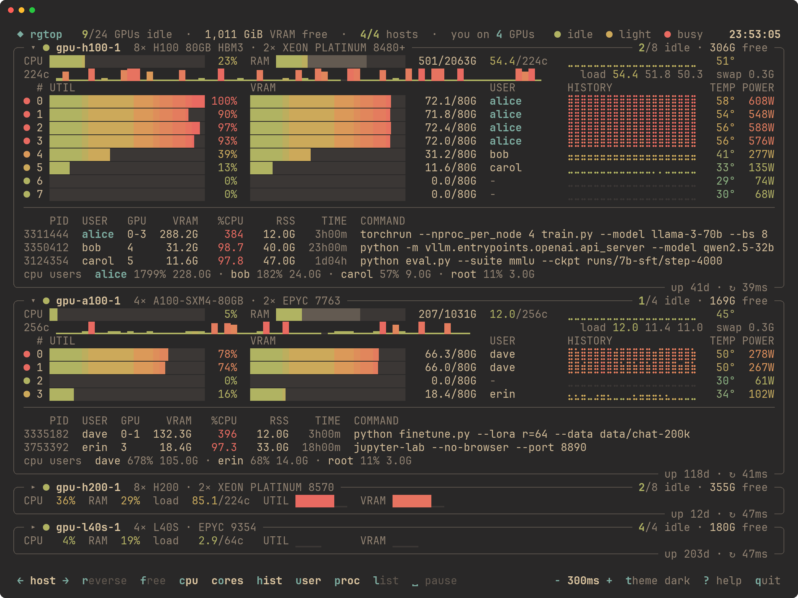
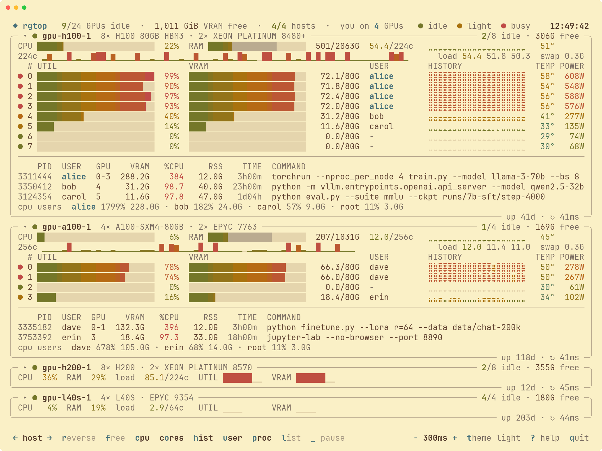

# <picture><source media="(prefers-color-scheme: dark)" srcset="docs/logo-dark.svg"><source media="(prefers-color-scheme: light)" srcset="docs/logo-light.svg"></picture>

[](https://github.com/xianull/rgtop/releases/latest)
[](https://github.com/xianull/rgtop/actions/workflows/release.yml)
[](https://github.com/xianull/rgtop/releases)
[](LICENSE)
[](#安装)
[](https://www.rust-lang.org)

[English](README.md) | **简体中文**

**rgtop**（**r**emote **G**PU **top**，远程 GPU 版 top）是 btop 风格的多机 GPU / CPU / 内存实时看板。在本地运行，通过 SSH 连接各台服务器，键盘和鼠标都能操作。本地只有一个约 700 KB 的静态二进制，服务器上什么都不用装。

<picture>
  <source media="(prefers-color-scheme: dark)" srcset="docs/screenshot-dark.png">
  <source media="(prefers-color-scheme: light)" srcset="docs/screenshot-light.png">
  
</picture>

- **GPU 行**：利用率、显存、谁在用这张卡（`+N` 表示还有 N 个用户，你自己会高亮）、利用率历史、温度、功耗。圆点绿色是空闲（利用率和显存都 < 5%），黄色是轻度占用（都 < 40%），红色是繁忙；状态变化时颜色会渐变过去。
- **CPU 行**：和 GPU 列对齐，依次是 CPU 总占用、内存（已用部分用渐变色，page cache 用暗色接在后面）、1 分钟负载、CPU 历史曲线、CPU 封装温度。下面一行（按 `o` 开关）是每核热力条（核比格子多时，每格显示组里最忙的那个核），右边是 1 / 5 / 15 分钟负载和 swap。
- **进程列表**（`p`）：每张卡上的进程，带**当前** %CPU（100 = 一个核）和主机内存 RSS；最后一行是此刻最占 CPU 的用户，不管是不是 GPU 任务，方便找出谁在把 CPU 跑满。
- 标题显示 GPU 和 CPU 型号；底边显示开机时长和一次采样的往返耗时。

## 安装

支持 macOS 和 Linux（x86_64 / arm64）。最省事的是用 SSH 密钥免密登录各台服务器；要输密码的服务器也能用，见[密码登录](#密码登录)。服务器上只要装了 NVIDIA 驱动即可：有 python3（几乎所有 Linux 都有）时，rgtop 直接调用驱动自带的 NVML 库；没有时退回到运行 `nvidia-smi`。

```bash
curl -fsSL https://raw.githubusercontent.com/xianull/rgtop/main/install.sh | sh
```

脚本会下载对应平台的二进制、校验 SHA-256，装到 `~/.local/bin/rgtop`。可选：

```bash
curl -fsSL https://raw.githubusercontent.com/xianull/rgtop/main/install.sh | RGTOP_INSTALL_DIR=/usr/local/bin sh
curl -fsSL https://raw.githubusercontent.com/xianull/rgtop/main/install.sh | RGTOP_VERSION=v4.0.0 sh
```

也可以从 [Releases](https://github.com/xianull/rgtop/releases) 手动下载 `rgtop-<arch>-<os>.tar.gz`，或者用 Rust 编译：`cargo install --git https://github.com/xianull/rgtop`。

升级就是重新跑一遍安装命令；卸载：`rm ~/.local/bin/rgtop`（设置在 `~/.config/rgtop/`）。

> 从旧版 gpustatus 升级：`~/.config/gpustatus/` 里的 hosts 和设置会被自动读取，环境变量 `GPUSTATUS_HOSTS` / `GPUSTATUS_THEME` 也仍然有效。

## 配置服务器

按 `~/.ssh/config` 里的 **Host 别名**连接（写法参考 `ssh_config.example`），按以下顺序取第一个非空的来源：

1. 命令行参数：`rgtop gpu-h100-1 gpu-h100-2`
2. 环境变量：`export RGTOP_HOSTS="gpu-h100-1 gpu-h100-2"`（空格或逗号分隔）
3. `~/.config/rgtop/hosts`：每行一个或多个别名，`#` 后是注释

连不上的机器只显示一个红色错误卡片并按退避间隔重连，不影响其他机器。

## 密码登录

要输密码、动态口令，或者第一次连接要确认主机指纹的服务器，也能直接用。rgtop 会暂时退出全屏，由 `ssh` 自己来问：rgtop 看不到、也不保存你的密码。登录成功后，`ssh` 会在后台保持这次登录（OpenSSH 的连接复用，socket 在 `~/.ssh/rgtop-<主机名>`）：rgtop 在用就一直保持，不用后再保留 8 小时，期间断线重连、重新打开 rgtop 都不用再输。换网络或电脑休眠仍可能让它断开，这时卡片会提示按 `L`。

- 启动时，每台需要登录的机器会自动问一次；在提示处按 `Ctrl-C` 跳过这台。
- 登录过期后，卡片上会提示：按 `L`（或点底栏的 `L login`）重新登录。
- 想提前断开登录：`ssh -O exit -o ControlPath=~/.ssh/rgtop-<主机名> <主机名>`。

密码登录成功后，rgtop 会问你要不要顺便把 SSH 公钥装到这台服务器上（走刚建立的登录，效果同 `ssh-copy-id`）：按 `y`，这台机器以后就不再问密码了。装的是 `ssh` 连这台机器时最先尝试的那个密钥文件（回答前会显示完整路径；还没有的话先 `ssh-keygen -t ed25519`），装完会实际验证一次：如果服务器坚持要密码或动态口令，rgtop 会如实告诉你。请注意这意味着什么：谁拿到这把私钥，谁就能不输密码、不输动态口令登录这台服务器。建议给私钥设口令（ssh-agent 会记住它）；如果单位要求动态口令，先确认是否允许这样做。

## 环境变量

| 变量 | 作用 |
| --- | --- |
| `RGTOP_HOSTS` | 命令行没给主机时要显示的机器：SSH 别名，空格或逗号分隔 |
| `RGTOP_THEME` | `auto`、`dark` 或 `light`：第一次保存设置之前用的配色；保存之后以保存的为准（按 `t` 切换，或用 `--theme` 临时指定） |
| `XDG_CONFIG_HOME` | 配置目录：`$XDG_CONFIG_HOME/rgtop/`（默认 `~/.config/rgtop/`） |
| `NO_COLOR` | 设成任意值：不显示颜色 |
| `COLORTERM` | `truecolor` 或 `24bit` 时使用 24 位真彩色（大多数现代终端会自动设置）；否则用 256 色 |
| `COLUMNS` | `rgtop -1` 的输出不是终端时（比如重定向到文件）使用的宽度，默认 80 |
| `RGTOP_INSTALL_DIR`、`RGTOP_VERSION` | 给 `install.sh` 用，见[安装](#安装) |

没设置 `RGTOP_` 开头的变量时，旧的 `GPUSTATUS_HOSTS`、`GPUSTATUS_THEME` 仍然有效。

只想这一次生效，就写在命令前面；想一直生效，就把 `export` 那一行加到 shell 的启动文件里：

```bash
# 只对这一次运行生效
RGTOP_HOSTS="gpu-h100-1 gpu-h100-2" rgtop

# zsh（macOS 默认）写进 ~/.zshrc；bash 写进 ~/.bashrc
echo 'export RGTOP_HOSTS="gpu-h100-1 gpu-h100-2"' >> ~/.zshrc
source ~/.zshrc          # 让当前这个终端立刻生效；新开的终端会自动生效

# fish
set -Ux RGTOP_HOSTS "gpu-h100-1 gpu-h100-2"
```

用 `echo $RGTOP_HOSTS` 检查是否设置成功。如果安装后提示 `rgtop: command not found`，用同样的方法把安装目录加进 `PATH`：`echo 'export PATH="$HOME/.local/bin:$PATH"' >> ~/.zshrc`。

## 使用

```bash
rgtop              # 实时看板（全屏）
rgtop -1           # 打印一次快照就退出；输出不是终端时自动这样
rgtop -n 0.1       # 以 100ms 刷新间隔启动
rgtop -n auto      # 每台机器一回数据就立刻再采（最多每秒 20 次）
rgtop --reset      # 忽略保存的设置
```

| 按键 | 作用 |
| --- | --- |
| `−` / `+` | 刷新间隔 ±100ms，立即生效；100ms 再往下是 `auto`：每台机器一回数据就立刻再采（最多每秒 20 次） |
| `←` / `→` | 主机排序：`host`（配置顺序）、`idle`（空闲卡多的在前）、`vram`（剩余显存多的在前）、`util`（最闲的在前） |
| `r` | 反转排序 |
| `f` | 只看空闲：隐藏繁忙的卡 |
| `c` `o` `h` `u` `p` | 开关 CPU 行、每核热力条、利用率历史、USER 列、进程列表 |
| `l` | 列表视图：每台机器一行；点某一行跳到该机器的卡片 |
| `1`–`9` / `a` | 折叠第 N 台 / 全部机器（也可以点卡片标题） |
| `空格` / `回车` | 暂停或恢复采样 / 立即采样一次 |
| `↑` `↓` `PgUp` `PgDn` `g` `G` 滚轮 | 滚动 |
| `t` | 配色：auto（按终端背景自动选）、dark、light |
| `m` | 开关鼠标捕获（关掉后可以选中复制文字） |
| `L` | 登录需要密码的机器，见[密码登录](#密码登录) |
| `?` / `q` | 帮助 / 退出 |

底栏和 btop 一样，每个按钮都能用鼠标点。刷新间隔、排序、各个开关、视图、配色、折叠了哪些机器，退出时保存到 `~/.config/rgtop/settings.json`。

### 配色

`auto` 会按终端背景自动选暗色或亮色；按 `t` 在 auto → dark → light 之间切换。

| 暗色 | 亮色 |
| --- | --- |
|  |  |

## 实现要点

- **每台机器一条 SSH 长连接，按需采样**：远端运行一个小 agent，本地每发一行请求，远端回一帧数据。所以改刷新间隔立即生效，暂停时完全不采样，任何一次采样都不用重新握手。断线后按 2s、4s、8s… 退避重连，最长 30 秒。
- **采样时远端零 fork**：agent（`src/agent.py`，只用 Python 3 标准库）在进程内通过 NVML 读 GPU、读 `/proc` 拿主机数据，一次采样约 1ms，而启动一次 `nvidia-smi` 要约 250ms。GPU 进程列表每秒刷新一次，每核热力条最快每 0.2 秒一次，全机 CPU 用户统计在后台线程里每 5 秒一次。服务器没有 python3 时，改用运行 `nvidia-smi` 的 shell 版 agent。
- **渲染**：每帧整体重建，再和上一帧逐格比较，只发送变化的格子（中间没变的部分用光标移动跳过），并用同步输出（DEC 2026）避免撕裂。新数据到来后，条形图、数字、状态圆点以最多 30fps 缓动约 0.3 秒，之后画面静止：每一帧都要终端和系统窗口服务器重绘，帧数越少电脑越不卡。
- **实测**（5 台服务器 × 8 卡）：2 秒间隔时，rgtop 本地占单核 0.4%、终端每秒重绘约 6 次，远端 agent 占单核 0.8%；100ms 间隔时，本地 1.9%（每秒重绘 28 次），远端 2.6%（服务器共 192 核）。内存 4 MiB。
- **不留残余进程**：rgtop 至少每 15 秒给每个 agent 发一次心跳（暂停时也发），agent 60 秒收不到任何东西就自动退出。即使断开时的关闭包没送到服务器（代理、VPN、电脑休眠），也不会在服务器上留下进程。
- **其他**：带了 `ClearAllForwardings=yes`，不会触发 `~/.ssh/config` 里配的端口转发；远端 shell 启动文件打印的内容会被忽略，远端数据里的控制字符不会原样输出到终端。CPU 占用由 `/proc/stat` 差值计算，内存已用 = `MemTotal − MemAvailable`。超过 `max(3 × 间隔, 间隔 + 8 秒)` 没有新数据的机器标记为 `stale`。

## 开发

```bash
cargo run -- host1 host2                                    # 调试运行
cargo test                                                  # 单元测试
cargo test --release -- --ignored bench_frame --nocapture   # 单帧耗时基准测试
uv run --with pyte --with pillow --with fonttools docs/screenshots.py   # 重新生成 README 截图（虚构的主机和用户）
git tag v4.1.1 && git push --tags                           # CI 编译 4 个平台并发布 Release
```

## License

MIT
